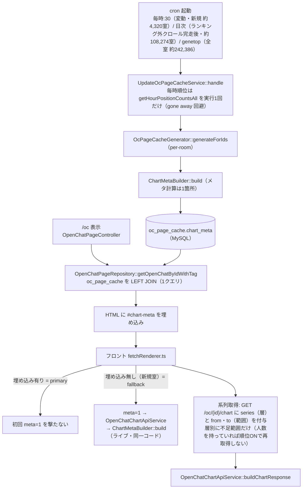
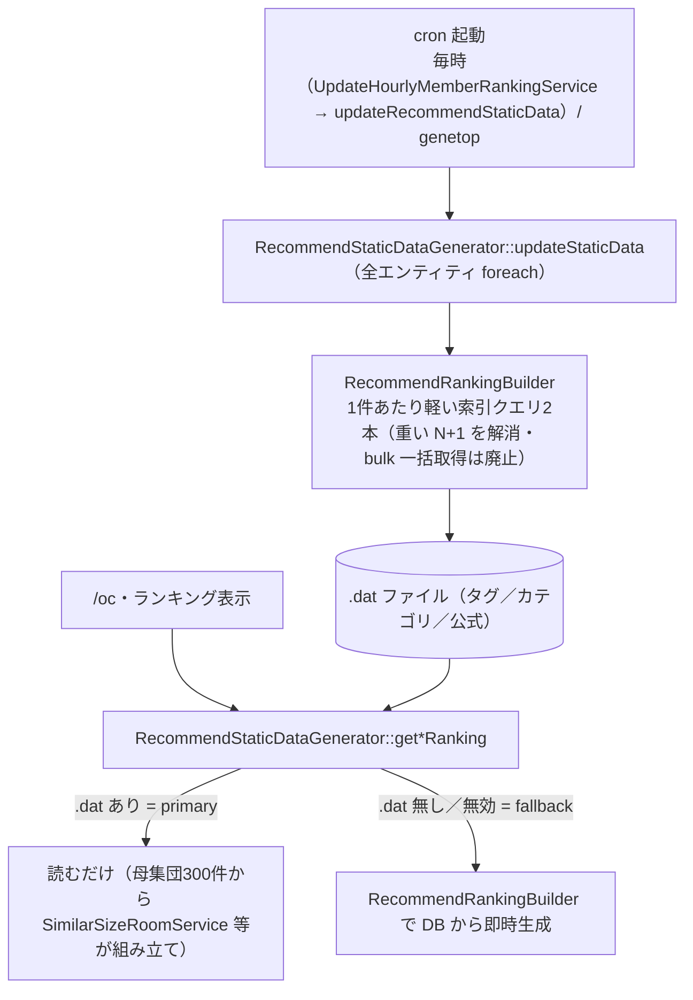

# オプチャグラフ（OpenChat Graph）

LINE オープンチャットのメンバー数を毎時記録し、ランキング・検索・成長グラフで見られるようにする Web サービス。

- サイト: https://openchat-review.me
- ライセンス: MIT（サイトもフレームワークも全ソース公開）
- 連絡先: support@openchat-review.me / X [@openchat_graph](https://x.com/openchat_graph)

## データを使う

約24万室のメンバー数推移・成長ランキング・LINE 公式ランキング順位履歴を外部から使えます。

- **MCP サーバー（認証不要）**: ChatGPT・Claude などに `https://openchat-review.me/mcp` を設定するだけ（[使い方](https://openchat-review.me/mcp)）
- **技術仕様・SQL 例**: [API_README.md](API_README.md)
- **サイト概要（機械可読）**: [llms.txt](https://openchat-review.me/llms.txt)

## 技術スタック

- PHP 8.5 + [MimimalCMS](https://github.com/pika-02-03/MimimalCMS)（自作の軽量 MVC フレームワーク。composer パッケージ `pika-02-03/mimimalcms`）
- MySQL/MariaDB（主データ）+ SQLite（ランキング・統計）
- React + TypeScript（Vite。`frontend/`）
- 開発環境は Docker Compose

## 開発環境

必要なもの: Docker（Compose V2）、mkcert

```bash
make init     # SSL 証明書・DB・storage を初期化（確認なしは make init-y）
make up       # 基本環境（実際の LINE サーバーにアクセス）
make up-mock  # Mock 環境（LINE Mock API 同梱。ネット接続なしで動く）
```

- サイト: https://localhost:8443（ポートは `.env` の `HTTPS_PORT`）
- phpMyAdmin: http://localhost:8080 / MySQL: localhost:3306 / LINE Mock API: http://localhost:9000

| コマンド | 内容 |
|---|---|
| `make down` / `restart` / `rebuild` / `ssh` | 停止・再起動・再ビルド・コンテナに入る（起動中の環境を自動判定） |
| `make cron` / `cron-stop` | Mock 環境で毎時クローリングを回す（:30 日本語 / :35 繁体字 / :40 タイ語） |
| `make build-frontend` | フロントエンドを全ビルド（`make init` でも実行） |
| `make phpstan` / `css-check` | 静的解析 / 色リテラル検査 |
| `make ci-test` | CI と同じ Mock クローリング＋URL テストをローカルで実行 |
| `make sync-setup` / `sync-update` | 本番データのミラーを取得 / 差分更新（要アクセス権） |
| `make up-shared` | 別リポの DB・storage を共有して2つ目のインスタンスを起動（[README.shared.md](README.shared.md)） |
| `make help` | 全コマンド |

- Xdebug は既定で無効。使うときは `ENABLE_XDEBUG=1 make up`
- 本番ミラーを入れると `.env` が `DATA_PROTECTION=true` になり、DB を作り直す `make init` / `up-mock` / `ci-test` は実行できなくなる
- 本番ミラー用の機密（SSH 鍵など）は非公開リポから取得する。アクセス権がなければ `batch/sh/prod-sync/secrets-example/` を書き換えるか、`PROD_SYNC_CONFIG_URL=...` で自前のリポを指定する

### フロントエンド

`frontend/` のソースをビルドして `public/js/` に出力する（成果物は git 管理外。デプロイ時に GitHub Actions でビルド）。

| ソース | 出力先 | 内容 |
|---|---|---|
| `frontend/oc-app/` | `public/js/oc-app/` | ルームページのグラフ・コメント（React + Chart.js） |
| `frontend/ranking/` | `public/js/react/` | ランキング（React） |
| `frontend/all-room-stats/` | `public/js/all-room-stats/` | 全体統計（Chart.js） |

ビルドは `make build-frontend`（個別は `make build-frontend:oc-app` など）。バックエンドを起動した状態で各ディレクトリの `npm run dev` を実行すると HMR 付きで開発できる（oc-app・ranking は API を `.env` の `HTTPS_PORT` にプロキシする）。

### フレームワーク（MimimalCMS）

`shadow/` と `shared/MimimalCMS_{Enums,ExceptionHandler,HelperFunctions}.php`・`shared/Exceptions/` は
composer パッケージ `pika-02-03/mimimalcms`（[MimimalCMS](https://github.com/pika-02-03/MimimalCMS)）のコピー。
本番は vendor を使わずこのコピーで動くので、git にもコミットしている。

- 直すとき: MimimalCMS リポで修正・タグ付け → ここで `docker compose exec app composer update pika-02-03/mimimalcms`（コピーが上書きされる）→ 差分ごとコミット
- 手で書き換えると次の update で消える。`docker compose exec app composer mimimalcms-check` でパッケージとの差分を確認できる
- `shared/MimimalCmsConfig.php`（DI バインド・設定）と `shared/MimimalCMS_Settings.php`（起動時の設定）はアプリ側のファイルで、同期の対象外

### DB にテーブル・カラムを追加する

`setup/schema/mysql/*.sql` を編集するだけ。デプロイ時に不足分だけが自動で追加される（削除・型変更はしない）。
事前確認は `docker compose exec app php batch/exec/sync_mysql_schema.php --dry-run`。詳細は [app/Services/Schema/README.md](app/Services/Schema/README.md)。

### テスト・CI

- ユニットテスト: `docker compose exec app vendor/bin/phpunit <path>`
- CI（`.github/workflows/ci.yml`）: Mock 環境でのクローリング＋URL テスト（phpunit は CI では走らない）
- CI だけ飛ばす: PR に `skip-ci` ラベル、またはタイトルを `skip-ci:` 始まりに（デプロイは通常どおり走る）
- 長時間テスト: `./test-cron.sh`（10万件・本番並みの遅延で時刻を進めながらクローリング。回数は `docker/line-mock-api/.env.mock`）

## ディレクトリ構成

```
app/          アプリ本体（Config・Controllers・Models・Services・Views）
batch/        cron・バッチ処理
frontend/     フロントエンドのソース（ビルド → public/js/）
public/       公開ディレクトリ（静的ファイル・index.php）
setup/        DB スキーマ・初期化スクリプト
shadow/       MimimalCMS フレームワーク本体（composer パッケージからのコピー）
shared/       DI 設定・フレームワークの設定と共通関数
storage/      SQLite・ログ・キャッシュ・翻訳データ
```

---

## 🗂️ ページ系キャッシュの生成アーキテクチャ

`/oc` 等の表示を軽くするため、重い計算は cron で事前計算して保存し、表示時はそれを読むだけにしている。
共通の考え方は「事前計算 → 保存 → 表示は読むだけ／無ければその場で生成（フォールバック）」。2系統ある。

### グラフのメタ・系列（`oc_page_cache.chart_meta`／MySQL）

グラフ初回表示のタブ・ボタン出し分け判定（可用性メタ）を cron で事前計算して `oc_page_cache.chart_meta`
に持たせ、`/oc` の既存1クエリで一緒に読んでHTMLに埋め込む。系列データ（人数・順位・ローソク足）は
`?series=` で層別に「見えている期間の不足分だけ」取得する。



- 生成タイミング: 毎時（直近1時間で変動した室＋新規ランク入り）／日次（`getForDaily`＝変動8日＋新規＋週次更新。ランキング外クロール完走後に走る）／genetop（全室）。最長でも約1週間で全室が一巡する。
- フォールバック: 未生成室（新規室・初回バックフィル前）は埋め込みが無いので `meta=1` で同じ `ChartMetaBuilder` をライブ実行。primary（cron）と同一コードなので結果は一致する。

### おすすめ・ランキング（`.dat` ファイル）

おすすめ／カテゴリ／公式ランキングを事前計算して `.dat` に保存し、表示時は読むだけにする。



- かつては「タグ1件ごとに重い結合クエリを1本」投げる N+1 構造で、毎時バッチが1時間で完走せず次回に
  kill され続け、生成中に重いクエリを投げ続けて `/oc` 表示が「MySQL server has gone away」を多発させていた。
  現在は1件あたり軽い索引クエリ2本に置き換えて解消（bulk 一括取得も試したが廃止）。
- フォールバック: `.dat` が無い／無効なら DB から即時生成して表示する。

## トラブルシューティング

### SQLite をコピーしたあとに `attempt to write a readonly database`

SQLite は WAL モードのため、読むだけでも `-shm` / `-wal` を同じディレクトリに作る。コピーしたファイルやディレクトリの所有者が `www-data` でないと失敗するので、権限を付け直す。

```bash
docker compose exec app sh -c 'find /var/www/html/storage -name "*.db" -exec chown www-data:www-data {} + && find /var/www/html/storage/*/SQLite -type d -exec chmod 777 {} +'
```
